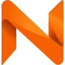

<div align="center">



# Nerva Connector

### Your computer, connected to Nexa.

<sub>Open apps, work with files and use the desktop on Windows, macOS and Linux, with the access you choose.</sub>

<br/>

[](https://github.com/dacely-cloud/nerva-connector/actions/workflows/windows-state.yml)
[](#install)
[](https://nodejs.org/)

<br/>


<br/>
<br/>

[Install](#install) · [First start](#first-start) · [Development & deployment](DEPLOYMENT.md)

</div>

---

## Introduction

Nerva Connector lets Nexa use your computer when you ask it to: open programs, read and write files, look at the
screen and use the mouse and keyboard. Link your computer to your Nerva account, choose what Nexa can do and
pick a folder for its work. Access lasts while the connector runs, and you can turn off full computer access
at any time.

## Install

### Windows

1. Download `Nerva-Connector-Setup-<version>-x64.exe` (`-arm64.exe` for ARM PCs).
2. Run it. If Windows says **Windows protected your PC**, click **More info**, then **Run anyway**.
3. Choose a writable installation folder with **Browse…** if you want a custom location, then click **Install**. No administrator rights are needed. Check **Start Nerva Connector in the background when I
   sign in** if Nexa should be able to use this computer whenever it is on.

Nerva Connector is added to the Start menu (and the desktop, if you leave that checked) and opens when setup
finishes. Continue with [First start](#first-start).

### macOS

You need [Node.js 26](https://nodejs.org) and git.

```sh
git clone https://github.com/dacely-cloud/nerva-connector.git
cd nerva-connector
npm ci
npm run build
npm start
```

So Nexa can see the screen and use the mouse and keyboard, allow **Screen Recording** and **Accessibility** for
Terminal in **System Settings → Privacy & Security**, then quit the connector and run `npm start` again.

### Linux

You need [Node.js 26](https://nodejs.org) and git.

```sh
git clone https://github.com/dacely-cloud/nerva-connector.git
cd nerva-connector
npm ci
npm run build
npm start
```

## First start

The connector asks a few questions. Use the arrow keys and Enter; Esc goes back.

1. **Get started.**
2. **Name** this computer. This is the name you see in Nerva.
3. **What Nexa can do:**
    - **Just connect for now**: Nexa sees that the computer is online, nothing more.
    - **Full computer**: Nexa can open programs, read and write files, see the screen and use the mouse and
      keyboard. You can turn this off at any time with `/disable-host`.
4. **Folder** Nexa works in. Press Enter to keep `Nexa Tasks` in your home folder.
5. **At sign-in** (Windows): start in the background when you sign in, or only when you open it.
6. **Review** your choices and press Enter.
7. **Link** the computer to your account: the connector shows a code. Open
   **https://nervalabs.com/chat/connectors**, enter the code and approve.

The screen then shows **Connected**. Nexa can use the computer while the connector runs: on Windows, while its icon
is next to the clock; on macOS and Linux, while the window is open.

## Everyday use

Open the connector:

- **Windows:** click the Nerva icon next to the clock (it may be under the **^** arrow), or Start menu →
  **Nerva Connector**.
- **macOS and Linux:** run `npm start` in the `nerva-connector` folder.

On Windows the connector keeps running in the background when you minimize its window; the icon next to the
clock brings it back. Right-click the icon to check for updates, turn **Start when I sign in** on or off, or quit.
`/quit` closes it too.

The screen shows whether the computer is connected, what Nexa is doing right now, which programs it started are
still running, and what it did recently. Press Tab to see the full history.

Type `/` to open the menu:

| Command         | What it does                                        |
| --------------- | --------------------------------------------------- |
| `/activity`     | Everything Nexa did on this computer                |
| `/settings`     | Change the name, the folder or what Nexa can do     |
| `/disable-host` | Turn off full computer access                       |
| `/reconnect`    | Connect again now                                   |
| `/startup`      | Windows: start in the background at sign-in, or not |
| `/log`          | Why recent connections ended, and the log file      |
| `/system`       | This computer's processor, memory and graphics      |
| `/pair`         | Link the computer, if it is not linked              |
| `/logout`       | Unlink this computer from your account              |
| `/quit`         | Close the connector                                 |

## Update

- **Windows:** updates install by themselves. Nerva Connector checks when it starts and every hour, installs a new
  version and starts again, keeping this computer's link and settings. Right-click its icon and choose **Check for
  updates** to check now, or run a newer setup file.
- **macOS and Linux:** in the `nerva-connector` folder run `git pull`, `npm ci` and `npm run build`, then
  `npm start`.

## Uninstall

To remove the computer from your account as well, open the connector and type `/logout` first.

- **Windows:** Settings → Apps → Installed apps → **Nerva Connector** → Uninstall. The link and settings stay in
  `%LOCALAPPDATA%\Nerva\Connector`; delete that folder to remove them.
- **macOS and Linux:** delete the `nerva-connector` folder. The link and settings are in
  `~/.local/share/nerva-connector`.

## Troubleshooting

**Screen snapshots ask for an updated approval.** Install the latest connector, then open `/settings`,
choose **Full computer** and approve the review. Updates that add computer tools need a new local approval;
your account link and activity history stay in place.

**It keeps disconnecting.** Type `/log` to see why. The full log is at:

- Windows: `%LOCALAPPDATA%\Nerva Connector\Logs\connection.log`
- macOS: `~/Library/Logs/Nerva Connector/connection.log`
- Linux: `~/.local/state/nerva-connector/connection.log`

**It can't sign in or keeps dropping right after connecting.** Check the computer's clock. On Windows open
Settings → Time & language → Date & time and click **Sync now**. A clock more than a few seconds off cannot sign in.

**Windows: it does not start, or an update did not install.** See
`%LOCALAPPDATA%\Nerva Connector\Logs\supervisor.log`, which records each start, stop and update.

**"Nerva Connector is already running on this computer".** Close the other connector window, or stop it in Task
Manager, and open it again.

**"Windows folder permissions block the connector".** Another Windows account can change the connector's folder.
In Command Prompt, look at who has access:

```bat
icacls "%LOCALAPPDATA%\Nerva"
icacls "%LOCALAPPDATA%\Nerva\Connector"
```

Only your account, `SYSTEM` and `Administrators` should have `(F)`, `(M)` or `(W)`. Sandboxed app entries
(`ALL APPLICATION PACKAGES`, `S-1-15-…`) are fine. Remove any other entry, replacing `NAME` with what icacls shows:

```bat
icacls "%LOCALAPPDATA%\Nerva" /remove:g "NAME"
```

If the computer was never linked, you can instead delete `%LOCALAPPDATA%\Nerva\Connector` and start again.

**Nexa can't see the screen on a Mac.** Allow **Screen Recording** and **Accessibility** for Terminal (see
[macOS](#macos)), then restart the connector.

## For developers

```sh
npm ci
npm run build     # build/nerva-connector.mjs and its helpers
npm test
npm run check     # typecheck, lint, format, build and tests
```

Building signed Windows and Linux releases, the Windows update feed and running the connector as a Linux service
are covered in [DEPLOYMENT.md](DEPLOYMENT.md).
